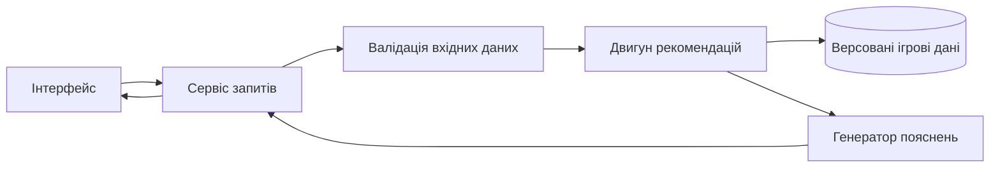

# Architecture — Архітектура системи

> Навчальний макет. Конкретні технології та спосіб отримання ігрових даних потребують окремої перевірки.

## Мета

Розділити інтерфейс, правила рекомендацій, ігрові дані та перевірку актуальності, щоб оновлення патча не вимагало переписувати весь продукт.

## Архітектурний стиль

**Монолітний багатошаровий** (Layered Monolith) — для MVP достатньо, полегшує розгортання та тестування. Можлива еволюція до клієнт-серверного з окремого API-шарю.

## Логічні модулі

| Модуль | Відповідальність | Інтерфейс |
|---|---|---|
| **Інтерфейс** | Приймає параметри матчу, показує результат, обробляє стани (порожній, завантаження, успіх, помилка, застарілий патч) | UI компоненти |
| **Сервіс запитів (API)** | Зв'язує інтерфейс з внутрішніми модулями, версіонує відповіді | `handleRequest(MatchContext): RecommendationResponse` |
| **Валідація** | Перевіряє обов'язкові поля, допустимі значення, версію даних, нормалізує ідентифікатори | `validate(MatchContext): ValidationResult` |
| **Двигун рекомендацій** | Застосовує правила до героя, ролі, супротивників, стадії матчу | `generate(MatchContext): List<Recommendation>` |
| **Сховище даних** | Містить героїв, предмети, здібності, патч, джерело оновлення; версіоноване | `refresh()`, `getHero(id)`, `getItem(id)` |
| **Генератор пояснень** | Пов'язує рекомендацію з причинами, а не видає тільки назву предмета | `generate(Recommendation, MatchContext): String` |

## Границі відповідальності

Модуль рекомендацій не повинен залежати від інтерфейсу. Всі зовнішні дані проходять перевірку до обчислення, а відповідь містить версію набору даних та попередження, якщо вона не підтверджена для поточного патча.

## Безпека

Проект не автоматизує ігрові дії, не втручається в процес гри та не обходить античит. Доступ до зовнішніх джерел повинен бути дозволеним, мінімальним та задокументованим.

## Відкриті рішення

- спосіб та розклад завантаження ігрових даних;
- формат зберігання правил та версій патчів;
- необхідність авторизації;
- межі кешування та час життя результату;
- допустимий формат інтеграції інтерфейсу.

## Масштабування та розширення

- Окремий API-шар дозволяє кілька клієнтів (web, desktop, overlay).
- Правила рекомендацій можна винести в окремий rule engine.
- Кешування результатів для повторних запитів однакових параметрів.
- Підтримка кількох мов пояснень.