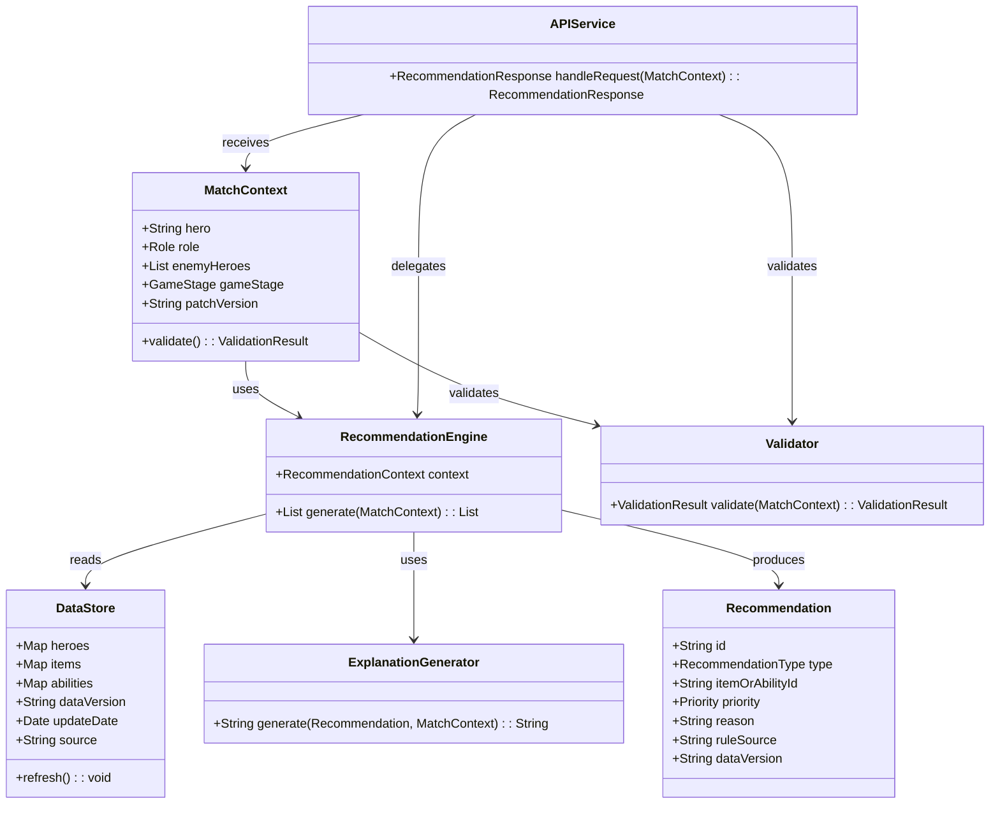

# Class Diagram — Діаграма класів

## Головні класи предметної області

| Клас | Атрибути | Методи | Призначення |
|---|---|---|---|
| `MatchContext` | hero, role, enemyHeroes, gameStage, patchVersion | validate() | Контекст запиту користувача |
| `Recommendation` | id, type, itemOrAbilityId, priority, reason, ruleSource, dataVersion | — | Результат рекомендації |
| `RecommendationEngine` | context | generate(MatchContext) | Основна логіка пошуку правил |
| `DataStore` | heroes, items, abilities, dataVersion, updateDate, source | refresh() | Версіоноване сховище ігрових даних |
| `Validator` | — | validate(MatchContext) | Перевірка вхідних даних |
| `ExplanationGenerator` | — | generate(Recommendation, MatchContext) | Формування текстових пояснень |
| `APIService` | — | handleRequest(MatchContext) | Точка входу для інтерфейсу |

## Звʼязки

- `MatchContext` — вхідні дані, не залежить від інших класів.
- `RecommendationEngine` читає `DataStore`, використовує `ExplanationGenerator`, створює `Recommendation`.
- `Validator` перевіряє `MatchContext` до передачі в `RecommendationEngine`.
- `APIService` — фасад, що зв'язує інтерфейс із внутрішніми модулями.