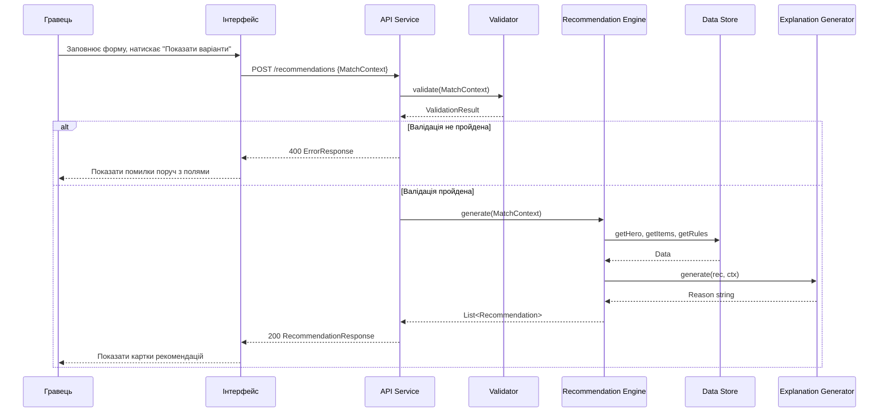
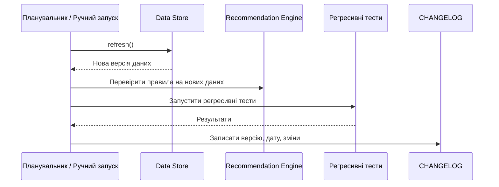

# Integration Plan — План інтеграції

## Порядок інтеграції модулів

1. **Data Store** — незалежний, завантажується першим.
2. **Validator** — залежить від схем, не залежить від Data Store.
3. **Explanation Generator** — залежить від формату рекомендацій.
4. **Recommendation Engine** — інтегрує Validator, Data Store, Explanation Generator.
5. **API Service** — обгортає Engine, Validator.
6. **UI** — інтегрується з API Service.

## Стіки модулів (Sequence Diagram)

### Основний сценарій: отримати рекомендації

### Сценарій: оновлення даних після патчу

## Можливі проблеми на стиках

| Стик | Проблема | Мінімізація |
|---|---|---|
| API → Validator | Новий обовʼязковий поле | Версіонування API, дефолтні значення |
| Engine → Store | Відсутні дані для героя/предмету | Fallback на попередню версію, попередження |
| Engine → Expl | Правило без шаблону пояснення | Дефолтний шаблон "Рекомендовано на основі правил" |
| UI → API | Зміна контракту | Версіонування в URL, сумісність назад |
| Store → External source | Джерело недоступне | Кеш останньої версії, retry з backoff |

## Тестування інтеграції

- Інтеграційні тести для кожного стоку (див. `4-quality/test-cases.md`).
- Контрактні тести API (Pact або схожі).
- Smoke-тест повного шляху UI → API → Engine → Store.