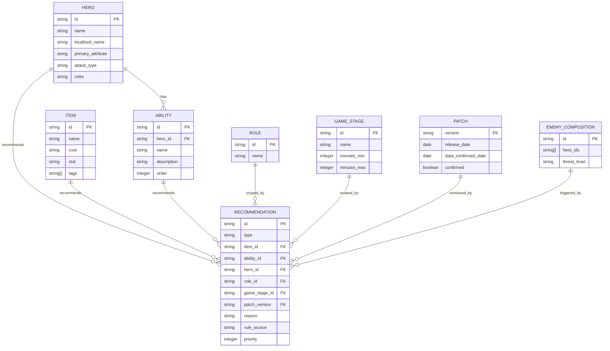

# Data Model — Модель даних

> Модель призначена для навчального прототипу і не є затвердженою схемою сховища даних промислового застосування.

## ER-діаграма

## Словник даних

| Сутність | Поле | Тип | Обов'язковість | Приклад | Примітка |
|---|---|---|---|---|---|
| HERO | id | string | так | `antimage` | Ідентифікатор героя |
| HERO | name | string | так | `Anti-Mage` | Внутрішня назва |
| HERO | localized_name | string | так | `Anti-Mage` | Локалізована назва |
| HERO | primary_attribute | enum | так | `agility` | Сила/Ловкість/Інтелект |
| HERO | attack_type | enum | так | `melee` | Мelee/Ranged |
| HERO | roles | string[] | так | `["carry","escape"]` | Ролі героя |
| ITEM | id | string | так | `black_king_bar` | Ідентифікатор предмета |
| ITEM | name | string | так | `Black King Bar` | Назва |
| ITEM | cost | integer | так | `3900` | Вартість |
| ITEM | slot | enum | так | `item_slot_1` | Слот |
| ITEM | tags | string[] | ні | `["magic_immunity"]` | Теґи |
| ABILITY | id | string | так | `antimage_mana_void` | Ідентифікатор здібності |
| ABILITY | hero_id | string FK | так | `antimage` | Герой-власник |
| ABILITY | name | string | так | `Mana Void` | Назва |
| ABILITY | description | string | так | `...` | Опис |
| ABILITY | order | integer | так | `4` | Порядок прокачки |
| ROLE | id | string | так | `carry` | Ідентифікатор ролі |
| ROLE | name | string | так | `Carry` | Назва |
| GAME_STAGE | id | string | так | `early` | early/mid/late |
| GAME_STAGE | minutes_min | integer | так | `0` | Хвилини від |
| GAME_STAGE | minutes_max | integer | так | `15` | Хвилини до |
| PATCH | version | string PK | так | `7.37d` | Версія патчу |
| PATCH | release_date | date | так | `2026-10-01` | Дата виходу |
| PATCH | data_confirmed_date | date | ні | `2026-10-05` | Дата підтвердження даних |
| PATCH | confirmed | boolean | так | `true` | Підтверджено |
| RECOMMENDATION | id | string PK | так | `rec_001` | Ідентифікатор |
| RECOMMENDATION | type | enum | так | `item` | item/ability |
| RECOMMENDATION | item_id | string FK | ні | `black_king_bar` | Якщо type=item |
| RECOMMENDATION | ability_id | string FK | ні | `antimage_mana_void` | Якщо type=ability |
| RECOMMENDATION | hero_id | string FK | так | `antimage` | Герой |
| RECOMMENDATION | role_id | string FK | так | `carry` | Роль |
| RECOMMENDATION | game_stage_id | string FK | так | `early` | Стадія |
| RECOMMENDATION | patch_version | string FK | так | `7.37d` | Версія даних |
| RECOMMENDATION | reason | string | так | `BKB дає імунітет...` | Пояснення |
| RECOMMENDATION | rule_source | string | так | `rule_001` | Джерело правила |
| RECOMMENDATION | priority | integer | так | `1` | Пріоритет 1-5 |
| ENEMY_COMPOSITION | id | string PK | так | `comp_magic_burst` | Склад супротивників |
| ENEMY_COMPOSITION | hero_ids | string[] | так | `["axe","cm"]` | Герої |
| ENEMY_COMPOSITION | threat_level | enum | так | `high` | Рівень загрози |

## Де і як зберігаються дані

- JSON-файли у `/data/<patch_version>/` (див. `adr/0002-data-format.md`).
- При старті Data Store завантажує JSON у пам'ять.
- Зовнішні сервіси: джерело ігрових даних (OpenDota/Stratz — на вибір, потребує підтвердження дозволу).

## Оновлення

Набір даних має мати версію, дату оновлення та джерело. Після виходу патча виконується повторна перевірка правил, тестів та прикладів у документації.