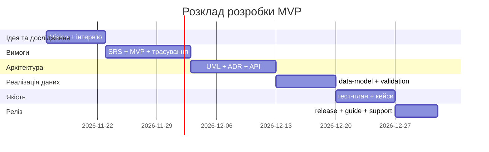

# Plan — План проєкту

## Декомпозиція робіт (WBS)

| WBS | Робота | Оцінка (story points) | Відповідальний |
|---|---|---|---|
| 1.0 | Ідея та дослідження | 8 | Аналітик |
| 1.1 | Vision, проблеми, користувачі | 3 | Аналітик |
| 1.2 | Інтерв'ю (5+) | 3 | Аналітик |
| 1.3 | Конкуренти, персони, CJM | 2 | Аналітик |
| 2.0 | Вимоги | 13 | Аналітик + Власник продукту |
| 2.1 | SRS (функц. + нефункц.) | 5 | Аналітик |
| 2.2 | MVP + MoSCoW | 3 | Власник продукту |
| 2.3 | Трасування | 5 | Аналітик |
| 3.0 | Архітектура та прототип | 21 | Архітектор |
| 3.1 | UML use case + класи | 8 | Архітектор |
| 3.2 | Стиль + компоненти + ADR | 5 | Архітектор |
| 3.3 | API + прототип | 8 | Архітектор + Розробник |
| 4.0 | Реалізація даних | 8 | Розробник |
| 4.1 | data-model.md | 3 | Розробник |
| 4.2 | validation-rules.md | 5 | Розробник |
| 5.0 | Якість | 13 | Тестувальник |
| 5.1 | test-plan + test-cases | 8 | Тестувальник |
| 5.2 | test-report + review-report | 5 | Тестувальник |
| 6.0 | Управління та реліз | 8 | Проєктний менеджер |
| 6.1 | plan.md + risks.md | 3 | Проєктний менеджер |
| 6.2 | release-plan + user-guide + support | 5 | Проєктний менеджер |

**Разом: ~71 story point.**

## Графік (діаграма Ганта)

## Віхи

| Віха | Дата | Результат |
|---|---|---|
| M1 | 2026-11-23 | Vision + інтерв'ю |
| M2 | 2026-12-07 | SRS + MVP + трасування |
| M3 | 2026-12-21 | Архітектура + API + прототип |
| M4 | 2027-01-11 | Дані + валідація |
| M5 | 2027-01-25 | Тест-план + кейси |
| M6 | 2027-02-08 | Реліз v1.0.0 |

## Контроль прогресу

Статуси задач: «Заплановано», «В роботі», «На перевірці», «Готово». Власник продукту слідкує, щоб команда не розширювала MVP за рахунок обов'язкових завдань.